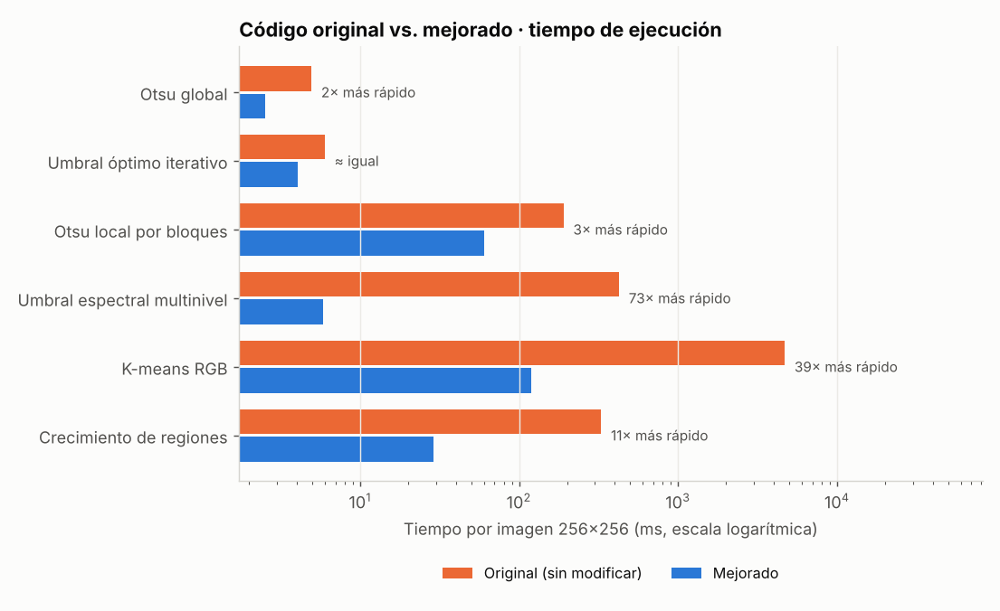

# Segmentor_and_Threshold · versión mejorada

Prueba de concepto para **Procesamiento Digital de Imágenes** (Ingeniería de Sistemas,
Facultad Politécnica – UNE, unidad 5: segmentación de imágenes).

Este repositorio es un *fork* de
[Computer-Vision-Toolkit/Segmentor_and_Threshold](https://github.com/Computer-Vision-Toolkit/Segmentor_and_Threshold),
de Ibrahim Fateen, Bassant Zaki, Mohamed Hisham y Yasmine Mahmoud. Partimos de su commit
`7ef53e7` y lo mejoramos en tres frentes:

1. **Corregimos el código original**: errores que lo hacían fallar y partes muy lentas.
2. **Agregamos las técnicas de la guía que faltaban**: discontinuidades, división y fusión, y movimiento.
3. **Agregamos una forma objetiva de compararlas**: escenarios con respuesta correcta conocida,
   métricas, un banco de pruebas y una app de demo.

## Cómo comparar el original con la versión mejorada

| Dónde | Qué hay |
|---|---|
| Rama [`original`](https://github.com/TVortexx/Segmentor_and_Threshold/tree/original) | El repositorio de los autores exactamente como lo encontramos |
| Carpeta [`original/`](original/) | Copia intacta de su código, ejecutable al lado del nuestro |
| Archivos de la raíz con el mismo nombre | Las mismas funciones, corregidas (`OtsuAndOptimal.py`, `KMeanSegmentation.py`, …) |
| [Historial de commits](https://github.com/TVortexx/Segmentor_and_Threshold/commits/main) | Un commit por mejora, con la explicación de qué cambió y por qué |
| App → pestaña **Original vs. Mejorado** | Ejecuta ambas versiones sobre la misma imagen y muestra el resultado, el tiempo y el diff del código |

## Instalación

```bash
git clone https://github.com/TVortexx/Segmentor_and_Threshold.git
cd Segmentor_and_Threshold
python -m venv .venv
.venv\Scripts\activate          # Windows   (Linux/Mac: source .venv/bin/activate)
pip install -r requirements.txt
```

| Para… | Comando |
|---|---|
| Abrir la **demo web** (recomendado para la presentación) | `streamlit run app.py` |
| Abrir la interfaz de escritorio **original**, sin cambios | `cd original` y luego `python main.py` |
| Abrir la interfaz de escritorio con los algoritmos **corregidos** | `python main.py` |
| Correr las **43 pruebas** automáticas | `python -m pytest -q` |
| Regenerar todas las **tablas y figuras** en `resultados/` | `python -m segpdi.benchmark` (≈ 1 min) |

Requiere Python 3.10 o superior. No necesita GPU ni internet.

## 1. Errores y problemas encontrados en el código original

| Archivo | Problema en el original | Corrección |
|---|---|---|
| `README.md` | Pide `pip install -r requirements.txt`, pero el archivo no existía | Se agregó `requirements.txt` |
| `OtsuAndOptimal.py` | Solo acepta rutas: el Otsu local **escribe cada ventana en `temp_window.png`** y la vuelve a leer | Acepta arreglos y trabaja en memoria |
| `OtsuAndOptimal.py` | Otsu marca como objeto `g >= T`, pero el nivel T pertenece al fondo | `g > T`; ahora coincide con scikit-image |
| `RegionGrowingSegmentation.py` | Con **256 semillas o más se cae**: `OverflowError: Python integer 256 out of bounds for uint8` | Etiquetas `int32` |
| `RegionGrowingSegmentation.py` | Una semilla fuera de la imagen provoca `UnboundLocalError` o copia la región anterior con otra etiqueta | Se ignora la semilla |
| `RegionGrowingSegmentation.py` | El algoritmo está mezclado con la interfaz PyQt5 y la cola usa `list.pop(0)`, que es O(n) | Separado en `region_growing_core.py`, con componentes conexas |
| `KMeanSegmentation.py` | Un bucle Python **por cada píxel** en cada iteración | Vectorizado con NumPy: mismo resultado exacto |
| `spectralThresholding.py` | Prueba los ~32.000 pares (t1, t2) con dos bucles y recalcula sumas en cada uno | Sumas acumuladas: mismos umbrales |

Resultado sobre una imagen de 256×256 (`resultados/original_vs_mejorado.csv`):

| Algoritmo | Original | Mejorado | Aceleración | ¿Mismo resultado? |
|---|---|---|---|---|
| K-means RGB | 3.000–6.400 ms | 70–170 ms | **26× a 68×** | Sí (con la misma inicialización) |
| Umbral espectral multinivel | 200–570 ms | 5–6 ms | **33× a 97×** | Sí |
| Crecimiento de regiones | 145–470 ms | 20–40 ms | **5× a 18×** | Sí |
| Crecimiento con 289 semillas | **se cae** | 105 ms | — | — |
| Otsu local por bloques | ~190 ms + archivos en disco | ~60 ms, sin archivos | 2× a 4× | Sí |



## 2. Técnicas nuevas (temas de la guía que el original no cubría)

| Tema | Técnica nueva | Archivo |
|---|---|---|
| Discontinuidades | Puntos, líneas en 4 direcciones, Sobel, LoG, detección combinada; Canny y Marr-Hildreth convertidos a regiones | `segpdi/tecnicas/discontinuidades.py` |
| Papel de la iluminación | Umbral adaptativo (media local) y corrección de fondo morfológica + Otsu | `segpdi/tecnicas/umbralizacion.py` |
| Varias variables | K-means en CIELAB con fondo automático; distancia de Mahalanobis | `segpdi/tecnicas/multivariable.py` |
| Crecimiento de regiones | Media actualizada, semillas automáticas y tolerancia según el ruido | `segpdi/tecnicas/regiones.py` |
| **División y fusión** | **Quadtree + fusión por gradiente de frontera** (aporte principal) | `segpdi/tecnicas/regiones.py` |
| Movimiento, espacial | Diferencias de frames, ADI, MOG2 (y MOG2 inicializado con mediana) | `segpdi/tecnicas/movimiento.py` |
| Movimiento, frecuencia | Energía de la FFT temporal; velocidad por correlación de fase | `segpdi/tecnicas/movimiento.py` |

## 3. Escenarios y métricas

Se usan imágenes sintéticas porque permiten conocer la **máscara correcta exacta**
(*ground truth*). Todo se genera con semilla fija y es reproducible.

| Escenario | Qué tiene | Qué técnicas rompe |
|---|---|---|
| **E1** Iluminación uniforme | 5 objetos claros, ruido leve | Ninguna: es la línea base |
| **E2** Iluminación no uniforme | Gradiente de luz 0.18× a 1.7× | Umbrales globales: ni el mejor umbral posible supera IoU 0.72 |
| **E3** Color isoluminante | Objetos de colores con el **mismo brillo** que el fondo | Todo lo que trabaja en escala de grises |
| **E4** Video | Dos objetos en movimiento con parpadeo de luz | Diferencia consecutiva y MOG2 sin inicializar |

Las métricas se definieron antes de experimentar (`segpdi/metricas.py`):

- **IoU** = VP / (VP + FP + FN). Es la métrica principal.
- **Dice**, **precisión**, **recall** y **tiempo** (mediana de 3 corridas).
- Para video: **IoU medio por frame** y **error de velocidad** (px/frame).

No se usa la exactitud como métrica principal porque el fondo ocupa el 72 % de la imagen:
marcar todo como fondo ya daría 72 %.

## 4. Resultados principales

**Las técnicas nuevas resuelven donde el original falla** (IoU, 1 = perfecto):

| Algoritmo original | E2 original | Técnica nueva | E2 nueva |
|---|---|---|---|
| Otsu global | 0.708 | Corrección de fondo + Otsu | **0.978** |
| Otsu local por bloques | 0.333 | Umbral adaptativo | **0.986** |
| Crecimiento de regiones (semilla) | 0.397 | Crecimiento por media con tolerancia automática | **0.943** |
| — (no existía) | — | División y fusión mejorada | **0.961** |

| Técnica | E1 | E2 | E3 |
|---|---|---|---|
| Canny | 0.980 | 0.979 | 0.015 |
| Otsu | 0.982 | 0.696 | 0.224 |
| Umbral adaptativo | **0.991** | **0.986** | 0.000 |
| K-means en color (Lab) | 0.921 | 0.439 | **0.995** |
| División y fusión (libro) | 0.888 | 0.372 | 0.000 |
| **División y fusión mejorada** | 0.976 | **0.961** | 0.000 |

| Movimiento (E4) | IoU medio |
|---|---|
| Diferencia consecutiva | 0.586 |
| MOG2 inicio en frío | 0.596 |
| Diferencia con referencia (mediana) | 0.967 |
| **MOG2 inicializado con mediana** | **0.991** |

La correlación de fase estima la velocidad de los objetos con un error de 0.14 y 0.29 px/frame.

Las tablas completas, los estudios de robustez y las ablaciones están en
[`resultados/RESUMEN.md`](resultados/RESUMEN.md).

## 5. Aportes propios medidos

| Aporte | Sin él | Con él |
|---|---|---|
| Fusión por gradiente de frontera (división y fusión) | E2: 0.372 | E2: 0.921 |
| Refinamiento a nivel píxel | E1: 0.899 | E1: 0.976 |
| Suavizado adaptativo al ruido | σ = 0.15: 0.501 | σ = 0.15: 0.963 |
| Corrección de iluminación por división (campo plano) | E2: 0.903 | E2: 0.978 |
| MOG2 pre-entrenado con la mediana temporal | 0.596 | 0.991 |
| Compensación del parpadeo de luz | 0.384 | 0.586 |

## 6. Limitaciones y casos de falla

- **Ninguna técnica en gris resuelve E3**, y k-means en color falla en E2 porque la luz crea grupos falsos.
- **El Otsu local por bloques del original** parte en dos las ventanas que solo tienen fondo (IoU 0.33).
  El umbral adaptativo lo resuelve, pero depende del tamaño de ventana.
- **El crecimiento de regiones depende de las semillas.** Con la grilla de 289 semillas, algunas caen
  en el fondo y lo marcan como objeto. Con criterio de media y un umbral grande, la región se "fuga".
- **Marr-Hildreth colapsa con ruido** desde σ ≈ 0.09.
- **Movimiento:** la diferencia consecutiva no ve el interior de objetos uniformes, y la FFT temporal
  marca la trayectoria del objeto, no solo su posición actual.
- **Los escenarios sintéticos** dan ground truth exacto, pero son más simples que las imágenes reales.
  La app permite probar imágenes reales y subir una máscara propia.

## Estructura

```
original/                  código de los autores SIN modificar (+ su README)
OtsuAndOptimal.py          versión corregida   ┐
KMeanSegmentation.py       versión vectorizada │ mismos nombres que en original/,
spectralThresholding.py    versión vectorizada │ usados por la interfaz main.py
RegionGrowingSegmentation.py  interfaz         │
region_growing_core.py     algoritmo sin PyQt  ┘
main.py, task04.ui         interfaz de escritorio de los autores
segpdi/                    paquete nuevo
  originales.py            ejecuta original vs. mejorado con la misma entrada
  tecnicas/                discontinuidades, umbralización, multivariable, regiones, movimiento
  escenarios.py, metricas.py, registro.py, benchmark.py, graficos.py
app.py                     demo web (Streamlit)
tests/                     43 pruebas
resultados/                tablas y figuras generadas por el benchmark
```

## Créditos

- Código base: Ibrahim Fateen, Bassant Zaki, Mohamed Hisham y Yasmine Mahmoud,
  [Segmentor_and_Threshold](https://github.com/Computer-Vision-Toolkit/Segmentor_and_Threshold).
  El repositorio original no declara licencia; se usa con fines académicos, citando a los autores.
- Mejoras: equipo de la Facultad Politécnica – UNE (Procesamiento Digital de Imágenes, 2026).
- Bibliotecas: NumPy, SciPy, scikit-image, OpenCV, Streamlit.
- Referencia teórica: R. C. Gonzalez y R. E. Woods, *Digital Image Processing*, 4.ª ed.
